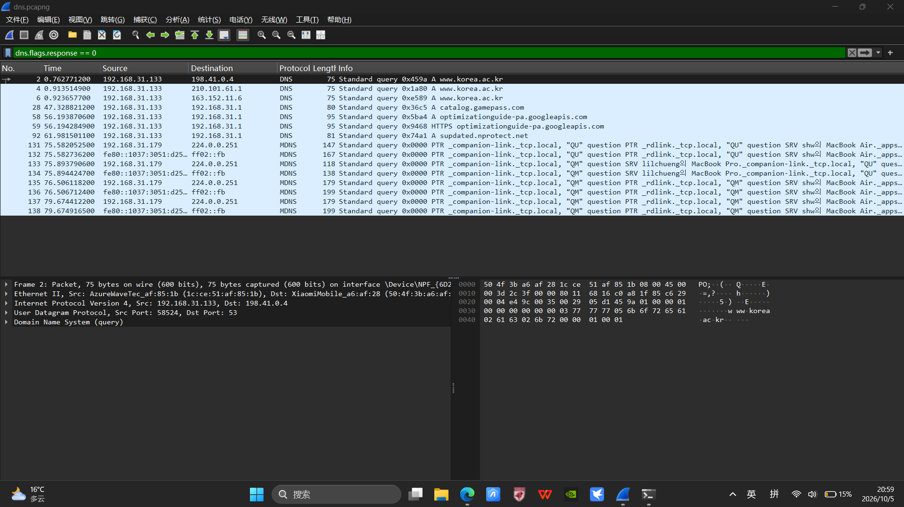
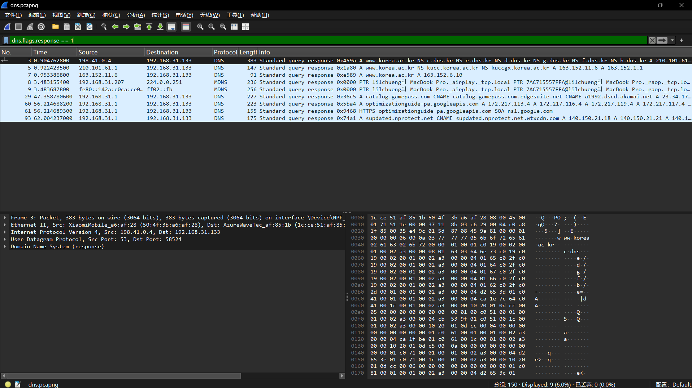
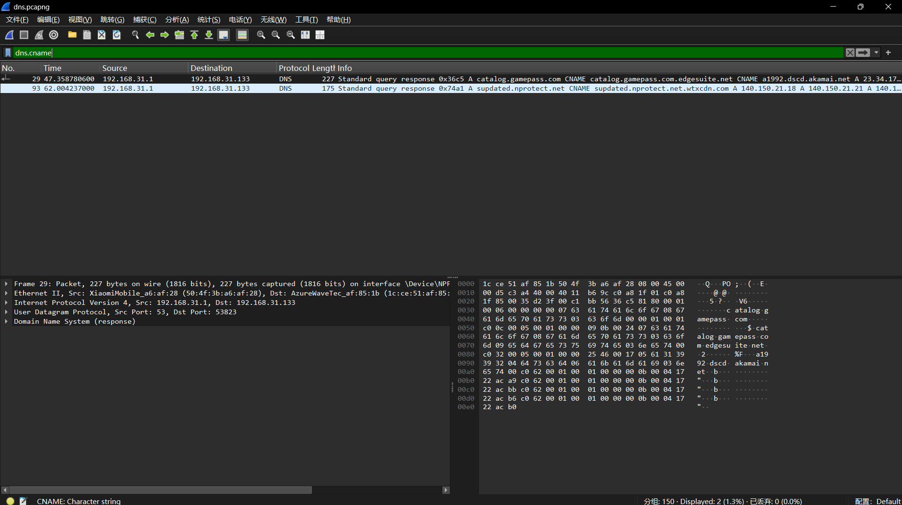

# Task2 DNS & CDN Steering Report
## Part A Wireshark DNS Capture
### A2: DNS Query Packet

- Transaction ID: 0x459a
- Query Domain: www.korea.ac.kr
- Query Type: A (IPv4)
- Source IP: 192.168.31.133
- Destination IP: 198.41.0.4
- UDP Source Port: 50524, Destination Port: 53

### A3: DNS A Record Response Packet

- Transaction ID: 0x459a
- Response source IP: 198.41.0.4
- Destination IP: 192.168.31.133
- UDP Source Port: 53, Destination Port: 58524
- Content: Returns name server records for korea.ac.kr zone

### A4: DNS Response with CNAME (CDN)

> Selected packet: Frame 29, query domain `catalog.gamepass.com`
- Transaction ID: 0x36c5
- CNAME chain:
  `catalog.gamepass.com` → `catalog.gamepass.com.edgesuite.net` → `a1992.dscd.akamai.net`
- This CNAME redirection is Akamai CDN steering mechanism.
- UDP Source Port: 53, Destination Port: 53823

## Part B CDN Steering Measurement
Two DNS resolvers are used for comparison:
- KR_ISP: 168.126.63.1 (Korean ISP DNS)
- US_GOOGLE: 8.8.8.8 (Google public DNS)
The full CNAME resolution chains are stored in `chains.json`.

### Observation
When querying the same domain from DNS resolvers located in different geographic regions, the CDN returns IP addresses of different edge nodes. The CNAME record is the core mechanism of CDN traffic steering, redirecting users to the nearest edge server to reduce network latency.

### Experiment Limitation
This experiment only uses two DNS resolvers and runs on a single host network. Firewall and UDP packet loss may cause DNS query timeout and affect experimental results. The sample size is small, so the conclusion has limitations.